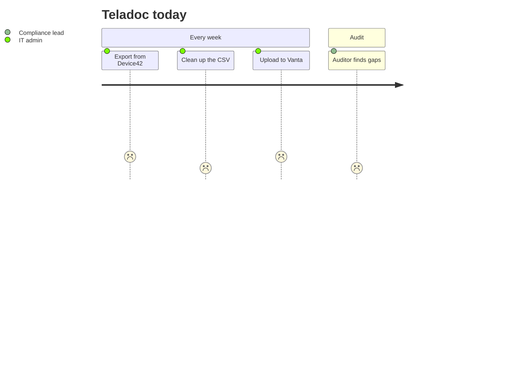
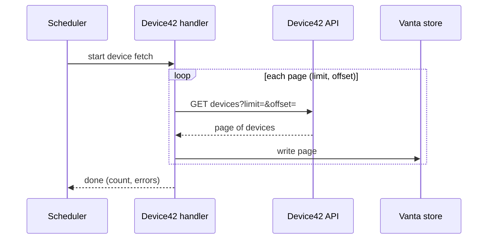
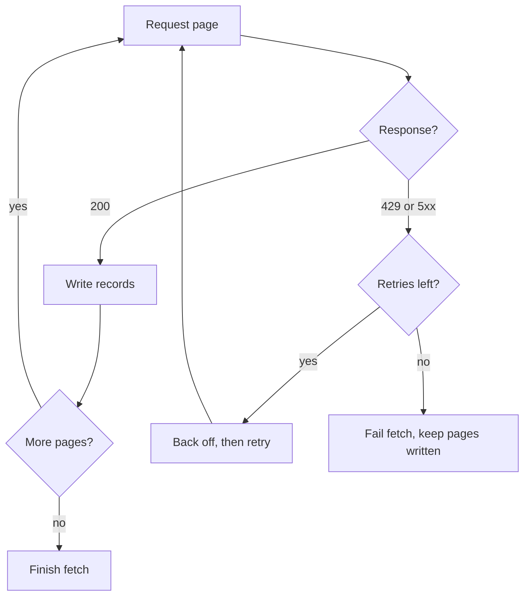
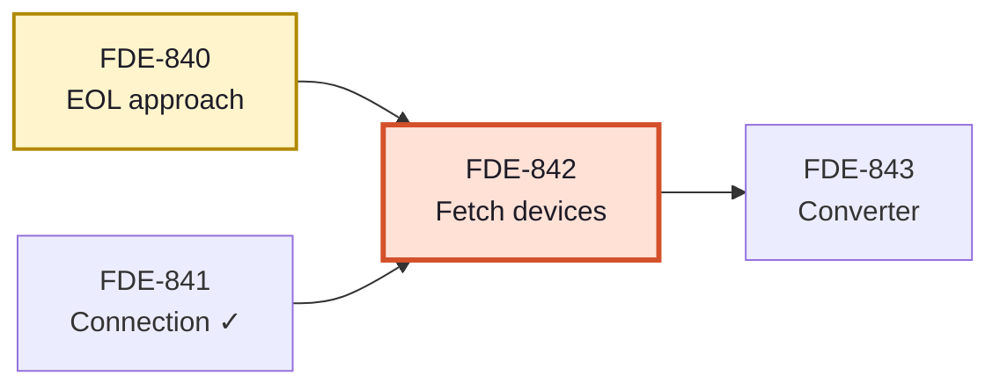
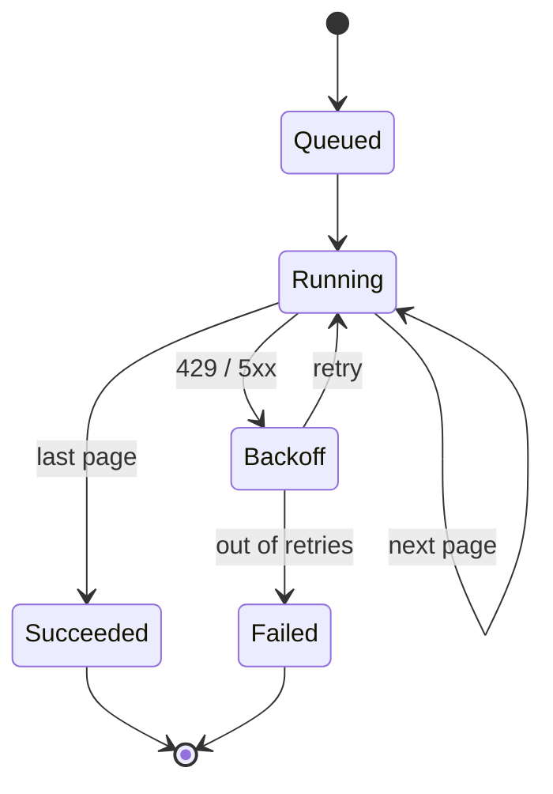
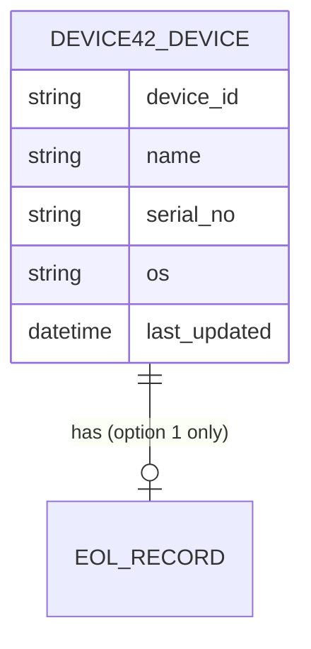
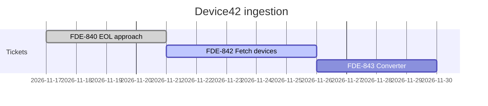

# Diagram cookbook for plans

## Default: the layers map and the flow map

Harman's two preferred diagrams (chosen 2026-11-25), drawn from one `layersmap` block:

- **Layers map**: parts of Vanta stacked in layers. Use for "what does this touch?"
- **Flow map**: the same parts left to right with arrows. Use for "how does data move?" and
  "what is downstream of this change?"

Click a ticket: the parts it changes light up orange, the parts it reads yellow. Click a part:
its tickets are listed and everything downstream lights up. Format and base data:
`vanta-layers.md`. `ws plan <box> <KEY>` draws both with a switch. Outside a plan (a feasibility,
a question in chat), put the block in `~/.claude/fde-plans/<name>.md`, validate it with
`check-plan.py <file> --map-only`, and give the `ws plan` command.

Tickets and the diagram go hand in hand: every ticket is on the map, every changed part has a ticket.

**Everything below is on request only.** Do not add these to a plan unless Harman asks.

## Other diagrams (Mermaid)

Pick the diagram by the question it answers. One diagram per question; never draw something a
table or a numbered list says just as well. All are Mermaid so they render in `ws plan`, GitHub
and Claude Docs. Check every diagram with `check-plan.py --render` before you hand the plan over.

| Question the reader has | Diagram | Mermaid type |
| --- | --- | --- |
| What part of Vanta does this touch? | Vanta layers map, affected parts highlighted | `flowchart TB` (copy from vanta-layers.md) |
| What does the customer go through, before and after? | Customer journey | `journey` |
| What happens, in order, between systems? | Sequence | `sequenceDiagram` |
| Where does the logic branch or retry? | Decision flow | `flowchart TD` |
| What blocks what? Which PR goes first? | Dependency graph | `flowchart LR` |
| What states can a record or job be in? | State machine | `stateDiagram-v2` |
| What data is stored and how does it relate? | Data model | `erDiagram` |
| When does each piece land? | Timeline | `gantt` |

Style rules (so every plan looks the same):
- Highlight with the two classes only: `hit` (changed) and `near` (read or depended on). Define
  them exactly as in vanta-layers.md.
- Label boxes with the customer or product word first, the code path second: `Device list device42/devices.ts`.
- Max ~12 boxes per diagram. Bigger means split it.
- Journey titles and steps: 3–4 words max (longer text gets cut off).
- Edge labels are verbs: `fetches`, `writes`, `triggers`.
- No colours other than `hit` and `near`.

## Examples (FDE-842, Device42 device fetch)

Illustrative only: they show the shape of each diagram. Field names, endpoints and the
customer workflow are placeholders, not checked against the spec or the code.

Customer journey, before:

Sequence (what happens on each fetch):

Decision flow (retries and rate limits):

Dependency graph (tickets):

State machine (a fetch run):

Data model:

Timeline:

