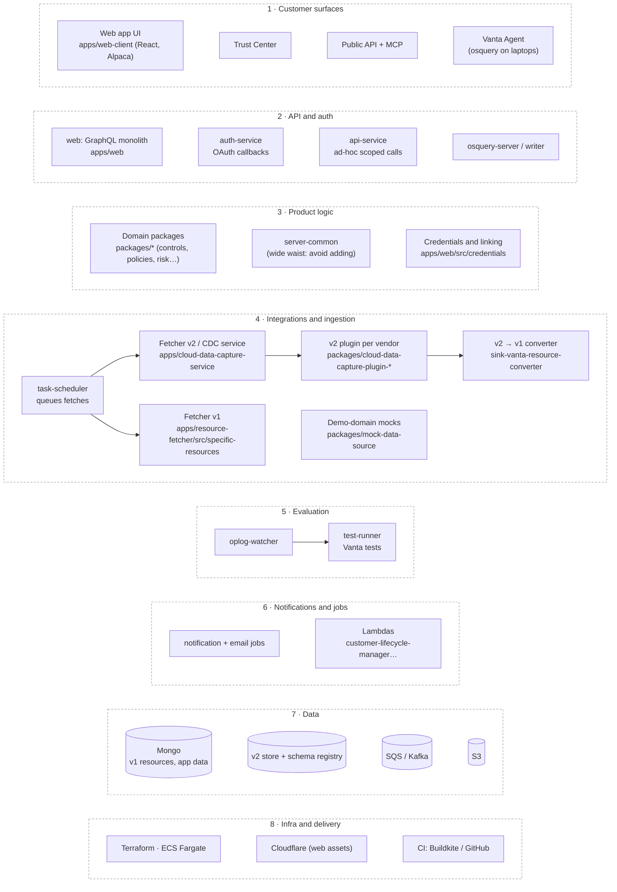

# Vanta layers map (v0.1, 2026-11-25)

A running map of obsidian (Vanta's monorepo) as layers, top = what customers touch, bottom = where
it runs. Every plan copies the diagram below and marks the parts the work touches with
`class <id> hit` (changed) or `class <id> near` (read or depended on, not changed).

**This is a living file.** When a plan finds a part that is missing, misnamed or wrong, fix it here
in the same PR as the plan (or tell Harman), and add a line to the changelog at the bottom. Keep
node ids stable: plans refer to them.

Sources for v0: [Vanta Architecture](https://app.getguru.com/card/irpd9eyT/Vanta-Architecture) (Guru,
marked partly out of date), [Code Structure](https://app.getguru.com/card/TR4nAL8c/Code-Structure),
[Guide 1: Migrating a Fetcher to V2](https://app.getguru.com/card/T8xkE7Ac/Guide-1-Migrating-a-Fetcher-to-V2),
[Schemas in V2](https://docs.google.com/document/d/1HbzgXCwq1U9HLA2FrVj4NOst3dBYfcCHGPmBIKv_dos),
[Demo Domains Foundations](https://docs.google.com/document/d/1gp18uS9dDZ5xlmYVuCQmtNg5yZZBHUhRdRJ-EBd-ZQ8).
Paths are where to start looking, not guarantees. Code is the ground truth: check with Glob/Grep.



## Node ids (use these with `class <id> hit|near`)

| Layer | Ids |
| --- | --- |
| 1 Customer surfaces | `webclient` `trust` `pubapi` `agentapp` |
| 2 API and auth | `web` `authsvc` `apisvc` `osq` |
| 3 Product logic | `domainpk` `servercommon` `creds` |
| 4 Integrations | `sched` `rfv1` `cdc` `plugin` `conv` `mocks` |
| 5 Evaluation | `oplog` `tests` |
| 6 Notifications | `notif` `lambdas` |
| 7 Data | `mongo` `v2db` `queues` `s3` |
| 8 Infra | `tf` `cf` `ci` |

## How a plan uses it (Harman's preferred diagram)

Plans show this map as an **interactive layers map**: click a ticket and the parts it changes
light up; click a part and the tickets that touch it are listed. The plan carries the data in a
fenced `layersmap` block; `ws plan` draws it. The Mermaid picture above is only the static overview.

1. Copy the base JSON below into the plan's section 6 inside a ```` ```layersmap ```` fence.
2. Add `"focus": "<KEY>"` and a `"tickets"` list: this ticket plus the other tickets in its epic.
   Each ticket: `{"key", "title", "status": "done" | "prog" | "back", "hit": [part ids it changes],
   "near": [part ids it reads or depends on], "notes": ["one line each, max 3"]}`.
3. Rename a part's `label`/`path` to the specific thing when it helps (`"Device42 handlers"`).
   Drop layers nothing in the epic touches, so the map stays small.
4. A part you need that isn't here: add it with `"new": true` (drawn dashed) and list it in the
   plan's "Map updates" so this file gets fixed.

```json
{
  "layers": [
    {"name": "1 · Customer surfaces", "parts": [
      {"id": "webclient", "label": "Web app UI", "path": "apps/web-client"},
      {"id": "trust", "label": "Trust Center", "path": ""},
      {"id": "pubapi", "label": "Public API + MCP", "path": ""},
      {"id": "agentapp", "label": "Vanta Agent", "path": "osquery on laptops"}
    ]},
    {"name": "2 · API and auth", "parts": [
      {"id": "web", "label": "web: GraphQL monolith", "path": "apps/web"},
      {"id": "authsvc", "label": "auth-service", "path": "OAuth callbacks"},
      {"id": "apisvc", "label": "api-service", "path": "ad-hoc scoped calls"},
      {"id": "osq", "label": "osquery-server / writer", "path": ""}
    ]},
    {"name": "3 · Product logic", "parts": [
      {"id": "domainpk", "label": "Domain packages", "path": "packages/*"},
      {"id": "servercommon", "label": "server-common", "path": "wide waist: avoid adding"},
      {"id": "creds", "label": "Credentials and linking", "path": "apps/web/src/credentials"},
      {"id": "vulns", "label": "Vulnerabilities service", "path": "packages/vulnerabilities-service"}
    ]},
    {"name": "4 · Integrations and ingestion", "parts": [
      {"id": "sched", "label": "task-scheduler", "path": "queues fetches"},
      {"id": "rfv1", "label": "Fetcher v1", "path": "apps/resource-fetcher/src/specific-resources"},
      {"id": "cdc", "label": "Fetcher v2 / CDC service", "path": "apps/cloud-data-capture-service"},
      {"id": "intbuilder", "label": "Integration Builder integration", "path": "packages/integrations/<vendor>"},
      {"id": "plugin", "label": "v2 plugin per vendor", "path": "packages/cloud-data-capture-plugin-*"},
      {"id": "conv", "label": "v2 → v1 converter", "path": "cloud-data-capture-vanta-resource-converter-*"},
      {"id": "mocks", "label": "Demo-domain mocks", "path": "packages/mock-data-source"}
    ]},
    {"name": "5 · Evaluation", "parts": [
      {"id": "oplog", "label": "oplog-watcher", "path": ""},
      {"id": "postfetch", "label": "post-fetch-consumer", "path": ""},
      {"id": "tests", "label": "test-runner", "path": "Vanta tests"}
    ]},
    {"name": "6 · Notifications and jobs", "parts": [
      {"id": "notif", "label": "notification + email jobs", "path": ""},
      {"id": "lambdas", "label": "Lambdas", "path": "customer-lifecycle-manager…"}
    ]},
    {"name": "7 · Data", "parts": [
      {"id": "mongo", "label": "Mongo", "path": "v1 resources, app data"},
      {"id": "v2db", "label": "v2 store + schema registry", "path": ""},
      {"id": "queues", "label": "SQS / Kafka", "path": ""},
      {"id": "s3", "label": "S3", "path": ""}
    ]},
    {"name": "8 · Infra and delivery", "parts": [
      {"id": "tf", "label": "Terraform · ECS Fargate", "path": ""},
      {"id": "cf", "label": "Cloudflare", "path": "web assets"},
      {"id": "ci", "label": "CI", "path": "Buildkite / GitHub"}
    ]}
  ]
}
```

## Changelog

- 2026-11-25 v0.1: added `vulns`, `postfetch`, `intbuilder`; base JSON for the interactive map.
- 2026-11-25 v0: first cut from Guru and v2 docs (Harman + Claude). Not yet checked against the code.
