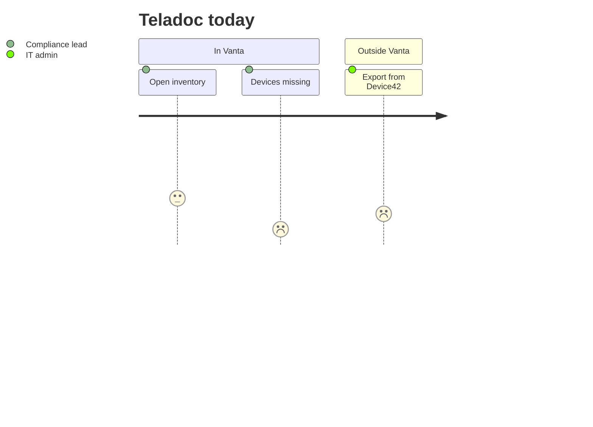
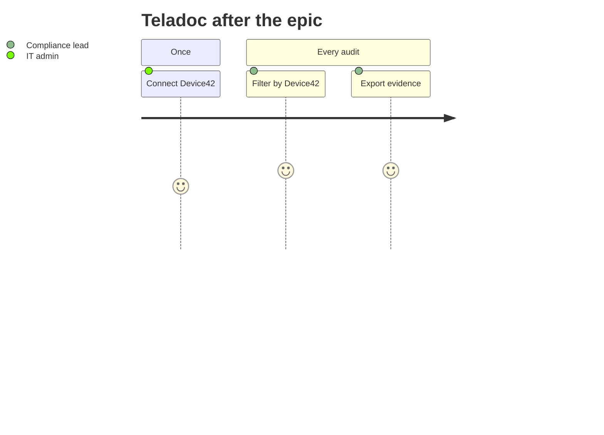
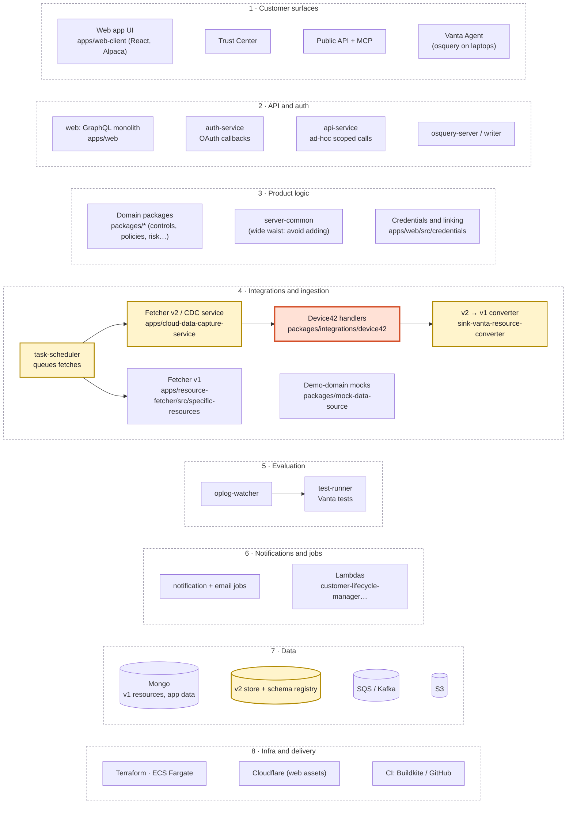
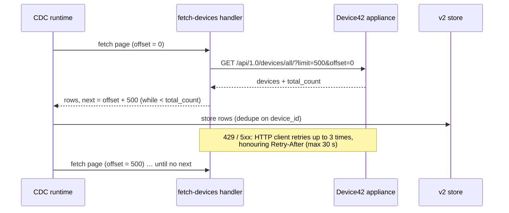
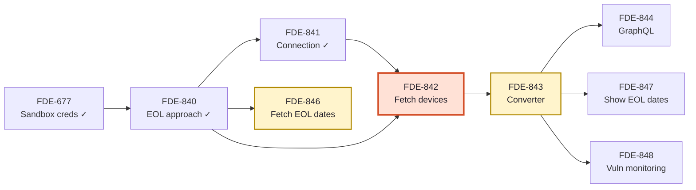

# FDE-842: Fetch all Device42 devices with pagination

> **TL;DR** Build the Device42 device handler that reads every Teladoc device into Vanta, 500 per
> page, so the inventory can list them with Device42 as the source. Size M (2 PRs). Unblocked pending
> one check: FDE-840 and FDE-841 are Done. The one open call is which EOL option FDE-840 picked, because it
> decides REST or DOQL for this handler.

| Ticket | Epic | Customer | Size | UI work? | Status |
| --- | --- | --- | --- | --- | --- |
| [FDE-842](https://vanta.atlassian.net/browse/FDE-842) | [FDE-308](https://vanta.atlassian.net/browse/FDE-308) | Teladoc Health | M, 2 PRs | No | Example plan (built while testing the skill) |

*How this example was made: research from Jira and the spec through Glean, run from the cloud
workspace, not an Ona box. Code paths come from the spec and have not been opened in the repo.
Questions in step 2 were answered with the proposals ("your call").*

## 1. Problem
Teladoc keeps its IT asset list in Device42 and wants Vanta's inventory to show the same devices,
with Device42 as the source, for audit evidence. Vanta has no Device42 integration. FDE-841 built
the connection; this ticket reads the devices. Teladoc is a retention risk, and Device42 was one of
their top integration asks when they signed.

## 2. Customer today
Device42 is Teladoc's system of record, but Vanta cannot see it. Their Azure integration is
connected but not used for assets, and their cloud footprint moves between Azure and AWS. The
customer workflow outside Vanta is not documented in the sources (see Risks).

## 3. Pain point
- The inventory Teladoc shows auditors does not match its real asset list, so Vanta is not the
  source of truth for devices.
- Device42 is a top-priority integration for an account at non-renewal risk.

## 4. Solution from the customer's side
After the whole epic ships, an admin connects Device42 once (URL plus a read-only API client).
Vanta then reads every device on a schedule. Laptops and workstations show as computers, everything
else as compute instances, all marked as coming from Device42, ready to filter and export. This
ticket is the reading part; the records appear on screen after FDE-843 and FDE-844.

## 5. UI work
**No.** This ticket only fetches and stores rows. The inventory and computers pages change in
later tickets (FDE-844 GraphQL, then the UI cases the spec lists); design should confirm the asset
details layout there, not here.

## 6. Where this lands in Vanta
Layer 4 (integrations, fetcher v2 on Integration Builder) changes; the scheduler, store and later
converter are touched only as neighbours.

| Part | Change | Where (path, from the spec) |
| --- | --- | --- |
| `plugin` | New `fetch-devices` and `fetch-computers` handlers; manifest schema declares every field the endpoint returns | `packages/integrations/device42/src/v2/handlers/`, `manifest.json` |
| `cdc` | No change; runs the handlers and stores rows | `apps/cloud-data-capture-service` |
| `v2db` | No change; rows land here, deduped by `idField: ["device_id"]` | `resources/Device42*.yml` |
| `conv` | Next ticket (FDE-843) | `cloud-data-capture-vanta-resource-converter-*` |

## 7. How it works
Offset pagination on the REST device list (EOL option 2), modelled on the Splunk on-prem handler.

## 8. Steps (PR-sized)
1. **Device42: fetch devices with pagination** · `fetch-devices.ts`, manifest schema for every
   `/devices/all/` field, `ssrfProtection = true`, self-signed option honoured, token refresh mid-sync · verified by
   handler unit tests (pages, last page, 429 retry, 401, token expiry) and a sandbox run.
2. **Device42: fetch computers handler** · `fetch-computers.ts` reading the same list for the
   ManagedComputer resource. Separate PR because each manifest resource maps to one product kind
   (spec, Device types) · verified by unit tests and row counts matching step 1 in the sandbox.

Out of scope here: FDE-846 (EOL dates) and the converter (FDE-843).

## 9. Acceptance criteria and verifiers
| # | Criterion (from the ticket) | Verifier |
| --- | --- | --- |
| 1 | Handler matches the EOL option chosen in FDE-840 (REST list for option 2, DOQL without the EOL join for option 1) | Reviewer checks FDE-840's outcome against the handler |
| 2 | Resource schema declares every field the source returns | Diff manifest schema against a sandbox `/devices/all/` response |
| 3 | Device handler tests per the testing plan | `pnpm --filter @vanta/integrations-device42 test` (package name to confirm) |
| 4 | A long sync continues after the first token expires | Unit test with a token expiring mid-sync; `expiresAtFormat` set from the sandbox |

## 10. Risks and open questions
| Risk or question | Impact | Proposed answer | Owner |
| --- | --- | --- | --- |
| Which EOL option did FDE-840 choose? | High: REST vs DOQL handler | Assumed option 2 (REST) here; confirm in FDE-840 | Harman |
| Teladoc device count unknown; 30 s request timeout | Med | Start at 500 per page as the spec says; tune after the first sandbox run | Harman |
| Offset pagination can skip a device that changes mid-sync | Low | Accept: idField dedupes repeats, next sync fills skips (per spec) | — |
| Teladoc workflow outside Vanta not documented | Low for this ticket | Ask the CSM before the customer update | Harman |

## 11. Sources
- [FDE-842](https://vanta.atlassian.net/browse/FDE-842): acceptance criteria
- [FDE-308 epic](https://vanta.atlassian.net/browse/FDE-308) and linked tickets FDE-840/841/843/844/846/847/848: status and blockers
- [FDE Feasibility Evaluation: Device42 Asset Ingestion for Teladoc](https://docs.google.com/document/d/1heeoTOFKVUnV9CHppGtNOpxZdgD0RG283fKI8ZJ4fmo): customer context, Option A, API calls, pagination, retries, file paths

## 12. Map updates
- Layer 4 should name Integration Builder packages (`packages/integrations/<vendor>`) next to the
  CDC plugin packages. The v0 map only lists `cloud-data-capture-plugin-*`.

## 13. Reviewer notes
Verdict from plan-reviewer (Sonnet, no context): **Ready after fixes.** Applied: TL;DR now says
"pending one check"; token expiry moved into step 1; step 2's split explained; FDE-846 marked out
of scope. Not applied: real `path:line` checks (the repo was not available where this example ran;
on a box the reviewer opens the files), and the example notes stay because this is a demo.
